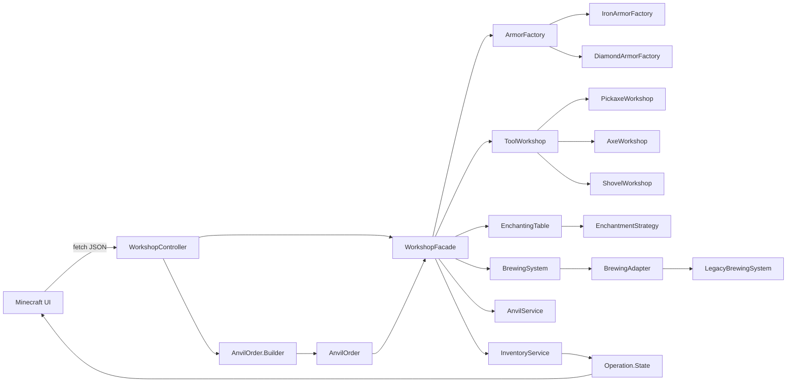
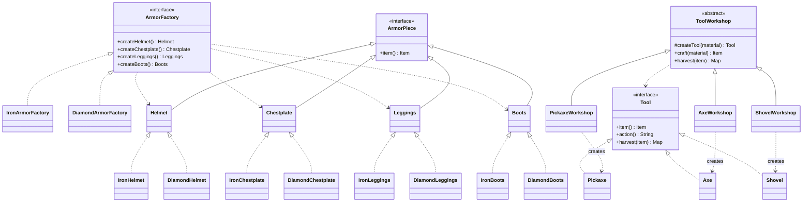
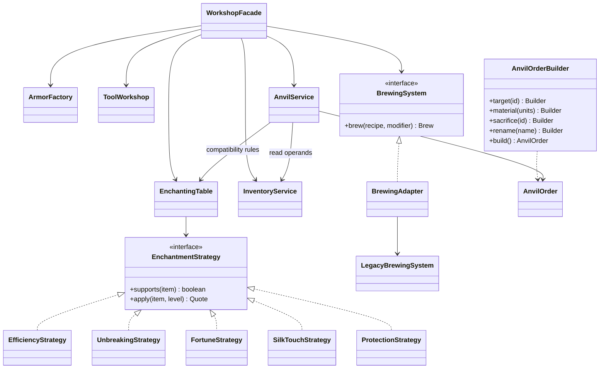
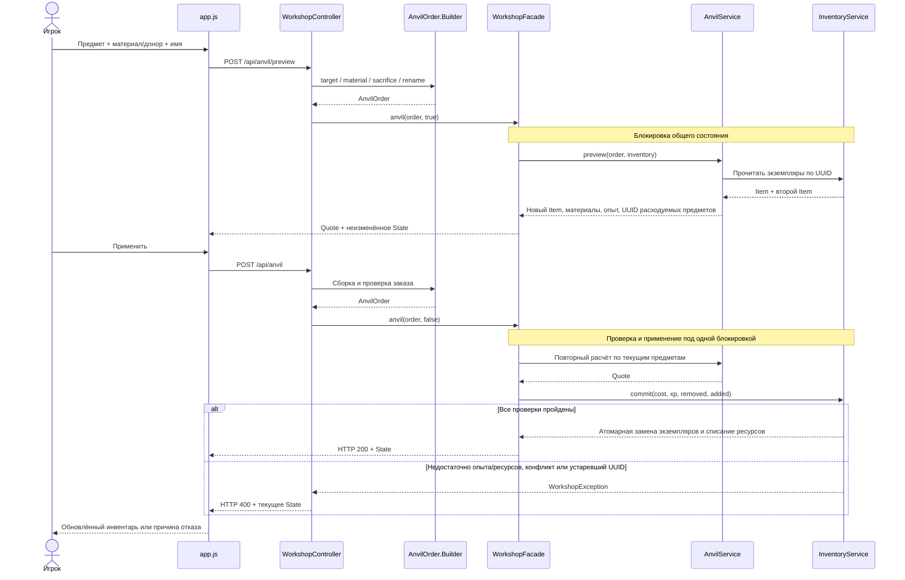

# Архитектура мастерской

JavaScript отображает серверный каталог и состояние игрока. Ни рецепты операций, ни совместимость чар, ни окончательная стоимость наковальни не определяются браузером. Предварительный просмотр и применение выполняются через разные endpoints; применение заново рассчитывает результат под общей блокировкой инвентаря.

## Компоненты

## Abstract Factory и Factory Method

ArmorPiece и Tool — интерфейсы продуктов. Абстрактные продукты брони — вложенные интерфейсы Helmet, Chestplate, Leggings и Boots. Каждая конкретная фабрика имеет собственные реализации: IronHelmet/DiamondHelmet и т. д. Реализации инструментов вложены в Tool. Item — неизменяемая модель экземпляра для хранения и передачи по API.

## Strategy, Adapter, Builder и Facade

`AnvilOrderBuilder` обозначает вложенный класс `AnvilOrder.Builder`. LegacyBrewingSystem — самостоятельная учебная библиотека с несовместимым контрактом: числовые коды ингредиентов и эффектов, длительность в секундах. BrewingAdapter переводит контракт приложения в этот API и обратно.

## Последовательность наковальни

## Целостность состояния

Предметы неизменяемы; snapshot не раскрывает изменяемые коллекции. Все модификации выполняются через копии ресурсов и экземпляров и применяются после проверок. Facade удерживает монитор InventoryService на всём протяжении составной операции. Ошибки расчёта и нехватка ресурсов не могут частично списать материал, опыт или второй предмет.

Стратегия зачарования создаётся на запрос и не хранится в изменяемом singleton-контексте. AnvilService использует общие правила совместимости и максимальных уровней Strategy, но выполняет объединение по собственным правилам наковальни.

Дальнейшая работа: БД, отдельные игроки, транзакции хранения, идемпотентные команды, полный набор чар и точные правила выбранной редакции Minecraft.
